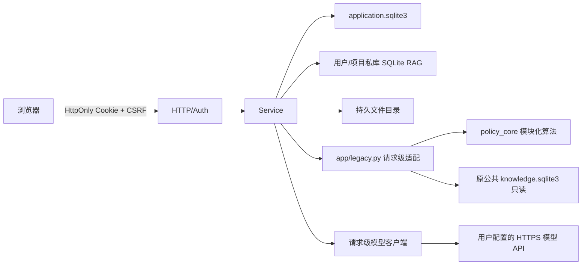
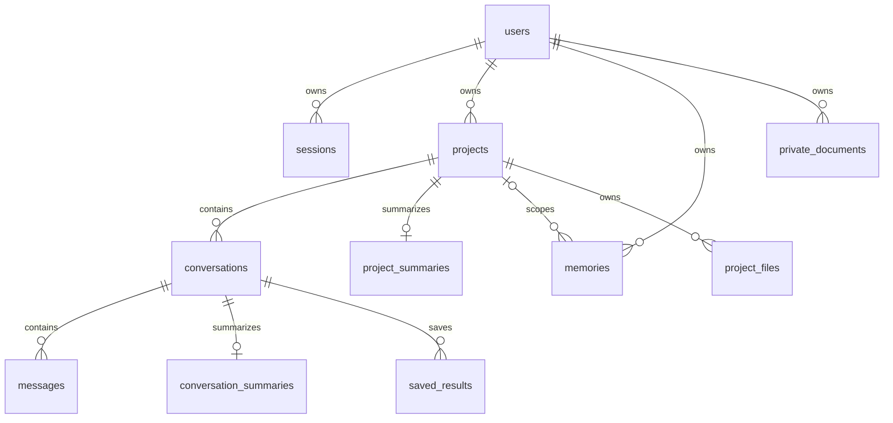
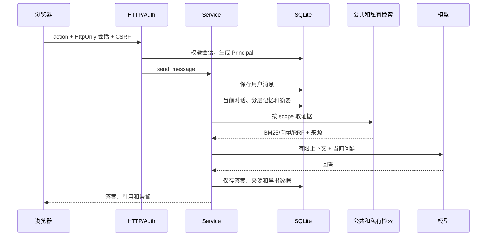

# 管策智研 V2：架构、运行与部署

## 已实现范围

新版使用独立入口 `应用平台_v2.py` 和 `app/`。原单体实现已按职责拆入 `policy_core/`，旧文件名保留为兼容入口，拆分前完整源码备份于 `backups/source_split_20261102_v1/`。`knowledge.sqlite3` 不参与此次修改，公共库继续以 SQLite `mode=ro` 打开。新版新增邮箱账户、项目/多会话、私人/项目知识库、用户模型配置、持久对话、记忆、上下文和来源/导出。模块定位见 [源码导航与模块拆分](源码导航与模块拆分_V1.md)。



登录注册使用邮箱和密码。密码以每用户独立随机盐和 PBKDF2-HMAC-SHA256（310,000 轮）派生后存储，不保存明文；注册、登录按来源 IP 限流。会话继续使用随机令牌，库里只存 SHA-256；Cookie 为 HttpOnly/SameSite，HTTPS 时加 Secure；POST 验证 Origin 和 CSRF。Principal 只从服务端会话取得。数据库迁移 003 为已有用户增加可空密码字段；通过旧验证码创建的账户不能直接用密码登录，需要管理员单独处理。

## 数据和知识库

应用数据库在 `APP_DATA_DIR/application.sqlite3`，版本化 SQL 位于 `app/migrations/`。升级先在线备份，使用原数据库 inode 上的事务执行并验证 quick_check/外键；失败 rollback，不替换活跃 DB。



用户私库位于 `user_knowledge/<user UUID>/knowledge.sqlite3`，项目库位于 `project_files/<user UUID>/<project UUID>/knowledge.sqlite3`。沿用 documents/chunks/FTS5；分类元数据含主题、子类、地区、行政级别、规划期。Markdown 标题路径及段落切片，检索用 FTS5 BM25 + 可选 cosine + RRF(k=60)，最多 8 条、同一文档取最佳片段。向量为 little-endian float32；模型、维度、generation 写入 index_state。换模型时先完整生成/校验向量并检查源快照，再原子切换；构建时旧索引可用，成功切换后不长期留旧版本。语义只在全量、匹配模型和维度时启用，否则关键词回退并返回告警。公共库只能用兼容 `BAAI/bge-m3` 的查询向量。

原文件按 UUID 用户/项目分区和随机文件名存储，文件权限 600，限制 20MB/文件、100 文件/用户；支持 TXT、MD、CSV、DOCX、可复制文字 PDF（系统需 pdftotext），没有 OCR。跨库文件/manifest 不能原子提交，采用失败清理补偿；异常断电可能留下不可见孤儿文件，需后续核对。

## 模型 API Key

浏览器按账户使用 PBKDF2 600,000 轮派生 AES-GCM 密钥，加密配置存 IndexedDB；解锁口令和 CryptoKey 不保存。Lock/退出会清运行时配置。调用时配置和 key 随当前请求传至后端，`app/models.py` 只在内存使用，不存数据库、不记录日志。**云端代理在处理期间可见 API Key 和提示词**，应使用 HTTPS 并信任服务器。服务端仅允许管理员批准的公网 HTTPS 域名，拒绝私网 DNS、环境代理和重定向，连接经过校验的 IP 并校验原域名证书。默认覆盖硅基流动、DeepSeek、阿里百炼；自定义主机须在 `MODEL_ALLOWED_HOSTS` 显式许可。

接口为 OpenAI 兼容 `/chat/completions`、`/embeddings`。模型可配置，无固定多模型分工。公共语义检索依赖与原索引一致的 BGE-M3；私人库可配置自己的 embedding，完整重建后切换。模型缺失时政策模式仍返回证据；项目自由对话需要用户 chat 配置。真实供应商、额度和连接未实测。

## 请求流程、记忆和上下文



记忆只用于新增项目聊天，不注入原政策证据校验提示。上下文优先项目摘要、相关项目记忆；明确问历史时再找摘要/原对话；全局记忆限稳定偏好。最近消息来自明确会话，当前问题只进入一次。按 UTF-8 字节数控制（保守界限，不是模型精确 tokenizer），超限先削减低优先内容，不能压缩当前要求。记忆可查看、修改、软删除和替代；抽取要求用户原话 quote 并由服务端验证，防止把助手建议当成用户事实。凭证过滤覆盖 Bearer/JWT/密钥标签等。后台任务只存 checkpoint 不存 key；用户解锁模型后按需重试。当前抽取仍同步执行，可能延长请求。

## 运行和云端部署

本机 Python 3.11+：复制 `.env.v2.example` 为 `.env.v2`，设置至少 32 字符随机 `AUTH_CODE_PEPPER`，再运行 `python3 应用平台_v2.py`，访问 `http://127.0.0.1:8766`。新认证流程不需要 SMTP。PDF 需系统 `pdftotext`。V2 使用独立 `data_v2/`，不导入旧进程内 RESULTS/SESSIONS 或用户数据。

云端建议 Docker Compose 或 systemd、Nginx 反向代理。非回环监听强制要求 HTTPS；校园网 VM 应使用校内域名和学校签发/信任的 HTTPS 证书，应用只绑定回环端口，Nginx 代理至应用。`APP_DATA_DIR` 必须映射到持久磁盘并设置权限/容量监控。模板在 `deploy/Dockerfile.v2`、`deploy/compose.v2.yaml`、`deploy/nginx.v2.conf`、`deploy/policy-v2.service`。`.dockerignore` 排除 `.env`、数据库及用户文档。详见下方校园网虚拟机操作步骤。

```sh
cp .env.v2.example .env.v2
chmod 600 .env.v2
# 配置 APP_ORIGIN、AUTH_CODE_PEPPER 后：
docker compose -f deploy/compose.v2.yaml up -d --build
```

### 校园网虚拟机部署（Ubuntu/Debian + Docker Compose）

以下假设虚拟机运行 Ubuntu/Debian，校园网客户端可路由到 `10.27.80.201`。先向学校确认系统版本、校园网客户端源网段、是否允许安装 Docker、入站端口，并申请校内 DNS 名称和受信任的 HTTPS 证书。默认以仅校园网访问为目标，不开放公网访问。应用对非回环监听强制 HTTPS；没有 HTTPS 证书前不要开放服务供真实账户使用。

1. 从校园网 SSH 登录虚拟机。首次登录后立即更改学校发放的初始 root 密码；为日常管理新建普通 sudo 用户，并尽量关闭 root 密码 SSH 登录。不要把密码写入命令、脚本或项目文件。
2. 确认系统与网卡地址：`cat /etc/os-release`、`ip -br addr`。确认地址 `10.27.80.201` 是虚拟机网卡当前地址且不会被 DHCP 改变；若不稳定，请让学校做 DHCP 保留或配置静态地址。
3. 更新系统并安装 Docker Engine 与 Compose 插件（按 Docker 官方 Ubuntu/Debian 仓库步骤安装）：`sudo apt update`。安装后确认 `docker --version`、`docker compose version`，并启用 `sudo systemctl enable --now docker`。
4. 将整个项目目录传至 `/opt/policy-app`（包括 `app/`、`policy_core/`、`deploy/`、`应用平台_v2.py`、`应用源码_示例知识库版.py` 和 `knowledge.sqlite3`）。例如在本地执行 `rsync -av --exclude '.env' --exclude '.env.*' --exclude 'data_v2' --exclude 'documents' --exclude '__pycache__' -e ssh ./ 用户名@10.27.80.201:/opt/policy-app/`。知识库约 300 MB，传输需预留磁盘空间。
5. 在 VM 上进入 `/opt/policy-app`，复制配置模板：`cp .env.v2.example .env.v2`。生成独立高熵 pepper：`openssl rand -hex 32`，将输出写入 `.env.v2` 的 `AUTH_CODE_PEPPER`。设置 `APP_HOST=0.0.0.0`、`APP_PORT=8766`、`APP_ORIGIN=https://校内域名`、`APP_DATA_DIR=/srv/data`、`PUBLIC_KB_PATH=/srv/public/knowledge.sqlite3`。SMTP 项可留空。配置文件权限设为 `chmod 600 .env.v2`。
6. 保持 `deploy/compose.v2.yaml` 的端口映射 `127.0.0.1:8766:8766`，让应用仅能从本机 Nginx 访问。编辑 compose 两条 volume：将 `../data_v2:/srv/data` 改为 `/srv/policy/data:/srv/data`，将 `../knowledge.sqlite3:/srv/public/knowledge.sqlite3:ro` 改为 `/opt/policy-app/knowledge.sqlite3:/srv/public/knowledge.sqlite3:ro`。准备持久化目录并给容器 UID 10001 写权限：`sudo mkdir -p /srv/policy/data && sudo chown -R 10001:10001 /srv/policy/data`。项目文件设置为管理员可读，避免普通用户读取 `.env.v2`。
7. 安装 Nginx，将 `deploy/nginx.v2.conf` 安装为站点配置并将 `server_name`、证书文件路径改为学校实际提供的值。证书和私钥安装至例如 `/etc/nginx/certs/fullchain.pem`、`/etc/nginx/certs/privkey.pem`，私钥权限限制为 root 可读。运行 `sudo nginx -t` 并重载 Nginx。Nginx 代理到 `127.0.0.1:8766`，并覆写 `X-Real-IP`；Compose 配置仅在该本机发布端口保持私有时才启用 `APP_TRUST_PROXY`，使登录限流按校园网客户端 IP 生效。浏览器访问 `https://校内域名`。
8. 在学校虚拟机防火墙/安全组和系统防火墙中，仅允许学校确认的校园网 CIDR 访问 TCP 443；拒绝其他来源。不要猜测校园网 CIDR，也不要添加 `0.0.0.0/0` 全放行规则。Ubuntu UFW 示例（将占位网段替换为学校提供值）：`sudo ufw allow from <校园网CIDR> to 10.27.80.201 port 443 proto tcp`，再检查 `sudo ufw status`。对外只开放 Nginx 的 443，不开放 8766。
9. 构建启动：`docker compose -f deploy/compose.v2.yaml up -d --build`；查看 `docker compose -f deploy/compose.v2.yaml ps` 和 `docker compose -f deploy/compose.v2.yaml logs --tail=100 policy`。确认健康检查通过后，从校园网客户端打开 `https://校内域名`，检查浏览器证书正常，再注册测试账户并验证登录、退出及资料库读取。
10. 服务器重启后检查 `docker compose -f deploy/compose.v2.yaml ps` 和 `sudo systemctl status nginx`。应用数据库和用户文件位于 `/srv/policy/data`，定期使用项目 `scripts/backup_v2.py` 做一致性备份并加密后复制到异机。更新代码时先备份数据，再同步代码，执行 `docker compose -f deploy/compose.v2.yaml up -d --build` 并检查日志。

如果学校没有校内 DNS/受信任证书，先向学校申请。也可申请包含 `10.27.80.201` IP SAN 的证书并通过 `https://10.27.80.201` 访问；普通自签证书会触发浏览器警告，不能作为正常投产配置。不能将 `APP_ORIGIN` 改成 HTTP 绕过 HTTPS 限制。

备份时停止服务。VM 上运行 `python3 /opt/policy-app/scripts/backup_v2.py backup --data /srv/policy/data --target /mnt/backup`，使用 SQLite backup API 并打包文件，备份应加密并存异机。恢复至不存在的目标目录：`python3 scripts/backup_v2.py restore --archive backup.tar.gz --target /srv/policy/restore`。恢复演练期间停服。迁移失败事务自动回滚；回退已成功升级时应停服后离线恢复 `.pre-migration-*.bak`，不可在线覆盖数据库。

## 验收与限制

运行 `python3 -m unittest discover -s tests -v`。测试覆盖迁移、文件路径、账户/项目隔离、密码/兼容验证码/会话/CSRF、真实 loopback HTTP、导出、模型 URL/DNS/重定向、记忆上下文、私库混合检索和向量原子切换。真实模型供应商、浏览器 UI、云服务器校园网连通性、HTTPS、多进程压力和真实备份恢复尚未实测。SQLite 适合当前单机部署；未来高并发需评估 PostgreSQL/对象存储迁移。

## V3 页面与导航调整（2026-11-02）

本次只调整 V2 应用的 `app/web/index.html`、`app/web/style.css` 和 `app/web/app.js`。沿用原智能体的墨绿、宣纸米白、灰绿导航、朱红点缀和宋体标题；首页、账户验证、研究工作台与设置中心使用同一套视觉变量。原单体应用 `应用源码_示例知识库版.py`、数据库、后端权限与 API 均未改动。修改前版本保存在 `backups/frontend_v2_20261102_v1/`。

### 页面入口

| 页面 | 地址片段 | 可见范围与用途 |
|---|---|---|
| 登录 | `#/login` | 默认入口，使用邮箱和密码登录 |
| 注册 | `#/register` | 使用邮箱、密码及确认密码创建账户 |
| 首页 | `#/home` | 登录后可从工作台进入的研究介绍页 |
| 研究工作台 | `#/workspace` | 登录后使用项目、对话、资料、研究与导出 |
| 账户设置 | `#/settings/account` | 显示名称、登录邮箱、退出账户 |
| 模型配置 | `#/settings/models` | 解锁本地配置、选择模型类型与服务商、编辑参数、加密保存与测试 |
| 记忆管理 | `#/settings/memory` | 自动提取开关、全局/当前项目记忆新增、编辑、删除、对话整理 |

使用原生 hash 导航，无需前端框架或反向代理重写；浏览器前进/后退、刷新设置子页均有对应状态。未登录时访问工作台或设置地址会引导登录。顶部齿轮仅在服务端会话验证成功后出现，模型与记忆不作为访客导航入口。前端显隐只负责交互，数据安全仍由后端 HttpOnly 会话、CSRF、用户/项目所有权验证保证。

### 账户验证交互

未登录访问根路径、首页或受保护工作台都会进入登录/注册页；两个状态可通过文本链接切换。注册要求两次密码一致，密码长度为 10 至 256 个字符。认证成功继续使用同源 HttpOnly 会话 Cookie，浏览器不保存密码。

首页问题在登录完成后填入工作台输入框，用户选择/创建项目与对话后主动发送。未配置聊天模型时，项目聊天引导进入设置的模型配置页。研究模式仍可在无聊天模型时返回政策证据。

### 设置与数据边界

账户、模型与记忆统一收纳到设置的二级页面，点击“返回研究工作台”保留当前项目、对话与未发送问题。进入设置不会更改数据存放位置：账户/项目/记忆继续保存在应用数据库，模型继续沿用按用户隔离的 IndexedDB AES-GCM 加密存储。模型参数在解锁后可编辑；原有加密存储名称、密钥派生参数和记录格式保持兼容。锁定与退出会清除内存中的密钥及明文字段；退出和会话失效也清空已渲染的账户资料、对话、记忆和原文内容。

记忆页标明工作台中当前选择的项目；未选择项目时不允许新增项目记忆，无当前对话时禁用整理操作。手机端将工作台调整为单列、设置导航调整为横排，表单保留可见标签及键盘焦点样式。原文仍使用弹窗阅读；账户、模型和记忆改为实际页面区域。

### 启动与验收

V2 仍通过 `python3 应用平台_v2.py` 启动（需要环境变量配置 `AUTH_CODE_PEPPER`，详见上文），默认端口为 8766。现有 `② 双击启动.command` 启动的是旧版 8765，不能用于查看 V2 页面。

本次后端回归执行 `python3 -m unittest discover -s tests -v`，41 项通过。前端执行 `node --check app/web/app.js` 及 DOM 引用/唯一 ID 检查；使用独立临时数据启动 HTTP 服务，确认三个前端文件均返回 200、内容与当前源码一致，并保留 CSP 与 nosniff 响应头。浏览器验收准备了测试邮件适配器，不发送真实邮件，不访问真实模型供应商；因浏览器未成功启动，未执行测试登录，也不代表真实 SMTP 投递验证。

**本次交付验证状态**：41 项后端回归、JavaScript 语法和静态 DOM 检查通过。独立 Chrome 启动受系统沙箱限制，申请启动审批时自动审批服务返回 `503 Service Unavailable`；未完成实际浏览器操作和视觉验收。用户已选择先交付代码，浏览器验收延后。后续应在桌面和手机尺寸检查：首页 → 注册 → 邮箱验证码 → 工作台 → 齿轮设置 → 账户/模型/记忆 → 返回工作台，以及刷新、前进/后退、会话失效与退出后页面显隐。真实 SMTP 邮件投递和模型供应商调用仍未验证。

## V4 邮箱密码登录与校园网部署（2026-11-02）

未登录访问默认进入登录/注册页，认证改为邮箱 + 密码。密码使用随机盐 PBKDF2-HMAC-SHA256 保存；新增迁移 `003_password_auth.sql` 保留已有账户数据，旧验证码账户仍需管理员设置密码。服务器仍须配置 `AUTH_CODE_PEPPER`，但不需要 SMTP。校园网 VM 部署说明以 Docker Compose + Nginx + 校内 HTTPS 证书为准，仅开放校园网来源的 443，应用端口只绑定回环。

本次执行 `python3 -m unittest discover -s tests -v`，43 项通过；`node --check app/web/app.js`、Python 编译和前端 DOM ID 检查通过。未连接学校虚拟机，校园网连通性及 HTTPS 证书尚未实测。

## 源码职责拆分（2026-11-02，页面调整之后）

`app/legacy.py` 现直接构造 `policy_core.runtime.PolicyEngine`，不再解析、编译或 `exec` 原单体文件。每次 V2 请求独立持有环境快照、缓存、锁和时间预算；公共数据库连接仍替换为只读连接，模型调用仍注入当前请求的客户端。`policy_core/` 的导入不加载旧版 `.env`，只有旧版兼容入口显式开启加载。页面与 API 使用方式不因本次拆分改变。

旧版内嵌首页已迁至 `policy_core/web/{index.html,style.css,app.js}`，通过受原访问令牌保护的 `/assets/style.css` 与 `/assets/app.js` 返回；原文预览的 CSS/JS 独立保存，在响应时继续内联，以维持原预览页 CSP。V2 页面仍位于 `app/web/`。容器打包增加 `COPY policy_core ./policy_core`，交付检查脚本改为检查模块和独立页面资源。

本轮按用户要求暂缓整套自检、测试套件与浏览器验收，仅作语法、导入和静态结构核对。上节 41 项通过属于拆分前的页面调整，不作为此次拆分的验收结论。待代码敲定后再运行模块导航中列出的完整回归。
