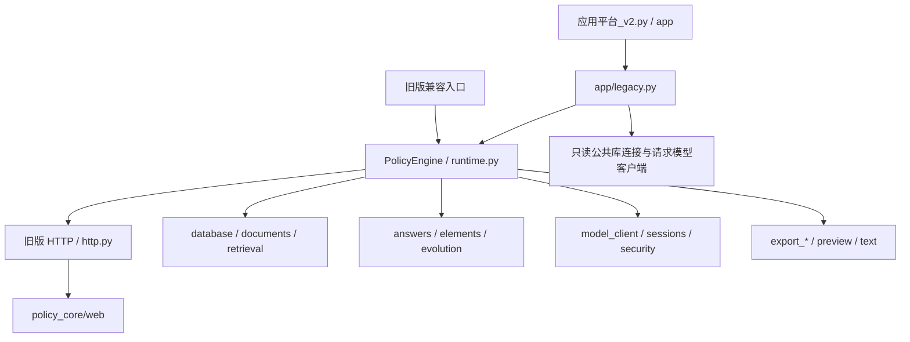

# 源码导航与模块拆分 V1

日期：2026-11-02。目标：把 `应用源码_示例知识库版.py` 的 3090 行按职责拆分，让后续改动能先定位到一两个文件，再沿调用链查看依赖。

## 先分清两个入口

| 使用场景 | 启动入口 | 页面文件 | 后端 |
|---|---|---|---|
| 旧版单机政策研究 | `应用源码_示例知识库版.py`，默认 8765；原双击脚本继续使用它 | `policy_core/web/` | `policy_core/http.py` → `PolicyEngine` |
| 登录注册、项目、模型与记忆设置 | `应用平台_v2.py`，默认 8766 | `app/web/` | `app/server.py` → `app/service.py`；公共算法通过 `app/legacy.py` → `PolicyEngine` |

**改登录、注册、设置和新版首页，请进入 `app/web/`。** `policy_core/web/` 是从旧单体提取出的旧版研究页面，两个目录对应不同入口。

## 模块地图

| 模块 | 职责 | 主要符号 / 搜索关键词 |
|---|---|---|
| `policy_core/config.py` | 环境快照、项目根目录、库/文档目录、大小限制、模型与时间预算配置 | `ROOT`、`Environment`、`configure`、`load_env_file` |
| `policy_core/runtime.py` | 组装引擎、创建实例状态、启动旧版服务 | `PolicyEngine`、`__init__`、`startup_check`、`main` |
| `policy_core/database.py` | SQLite 连接、schema 兼容升级、FTS 索引修复 | `db`、`_init_db`、`rebuild_fts`、`fts_terms` |
| `policy_core/documents.py` | 原文提取、语义切片、上传原件存储与索引 | `extract_text`、`_paragraphs`、`split_chunks`、`index_file` |
| `policy_core/text.py` | 纯文本工具、分词、规划期与文档分类 | `tokens`、`normalized_text`、`period_info`、`TOPIC_RULES`、`classify_document` |
| `policy_core/retrieval.py` | 地区/规划期范围、BM25、向量余弦、RRF、同文件去重 | `_metadata_scope`、`_scope_planids`、`retrieve` |
| `policy_core/model_client.py` | 旧版模型接口、嵌入分批、重试、超时、JSON 解析、向量编码 | `embedding_enabled`、`embed_texts`、`model_call`、`set_deadline` |
| `policy_core/errors.py` | 模型配置/额度类错误 | `ModelUnavailable` |
| `policy_core/answers.py` | 存在性判断、普通问答/多文件比较、主张校验与来源载荷 | `existence_answer`、`model_answer`、`sources_payload` |
| `policy_core/elements.py` | 四要素规则、模型引文检查、表格输出 | `ELEMENT_RULES`、`rule_elements`、`model_elements`、`extract_answer` |
| `policy_core/evolution.py` | 按地区及规划期逐期检索、引文校验、跨期输出 | `evolution_answer`、`_evolution_claims` |
| `policy_core/sessions.py` | 旧版进程内追问上下文与地区锚点 | `FOLLOWUP_HEAD`、`resolve_followup`、`remember_session` |
| `policy_core/export_xml.py` | OOXML 共用转义 | `xml_escape` |
| `policy_core/export_word.py` | Word 文档、表格、引用链接、页脚 | `make_docx`、`_docx_table` |
| `policy_core/export_excel.py` | Excel 工作簿、单元格与样式 | `make_xlsx` |
| `policy_core/export_slides.py` | PowerPoint 封面、结论、分期和证据页 | `make_pptx`、`_pptx_slide` |
| `policy_core/preview.py` | 原文选择、Markdown 展示、定位栏、高亮注入 | `find_preview_source`、`preview_page`、`with_highlight` |
| `policy_core/assets.py` | 从磁盘加载旧版页面和预览资源 | `WEB`、`INDEX`、`TOKEN_GATE` |
| `policy_core/security.py` | 审计轮转、回环识别、对外监听校验 | `audit`、`is_loopback`、`enforce_access_control` |
| `policy_core/http.py` | 旧版 HTTP 路由、令牌/限流、上传、下载、导出结果缓存 | `Handler`、`make_handler`、`parse_multipart` |
| `policy_core/__init__.py` | 包入口 | `PolicyEngine` |
| `policy_core/web/index.html` | 旧版首页 DOM | `tabs`、`q`、`result`、`sources` |
| `policy_core/web/style.css` | 旧版配色、布局、响应式与打印样式 | `:root`、`.topbar`、`@media` |
| `policy_core/web/app.js` | 旧版页签、问答、上传、引用与导出交互 | `MODES`、`run`、`render`、`apiFetch` |
| `policy_core/web/token_gate.html` | 旧版令牌引导页 | `token` |
| `policy_core/web/preview.css`、`preview.js` | 原文阅读样式与文本高亮 | `kgsz-hit`、`__KGSZ_NEEDLE__` |

## 组装方式与依赖

`PolicyEngine` 是明确的组装入口。数据库、文档、检索、分析、会话、预览等类分别只定义对应职责的方法（Mixin），统一由引擎实例承载状态；不再依赖原文件执行后产生的共享全局命名空间。Mixin 没有自己的构造或方法覆盖顺序要求，组装由 `runtime.py` 的显式导入给出。纯文本工具和 OOXML 导出保留为普通函数。

- 需要跨职责调用时，实例方法使用 `self.retrieve(...)`、`self.model_call(...)`、`self.db()` 等明确访问引擎服务。替换服务在实例上进行，避免模块之间循环导入。
- 配置在 `config.configure()` 初始化；`RESULTS`、`SESSIONS`、锁、数据库就绪标记、元数据缓存、语义告警、时间预算都在 `PolicyEngine.__init__()` 按实例创建。
- 规则常量放在所属模块：分类/分词在 `text.py`，四要素在 `elements.py`，追问开头在 `sessions.py`。`runtime.py` 仅提供兼容引用。
- `config.ROOT` 始终指向项目根目录，拆分后不会把数据库、原文或审计日志误写到包目录。
- 仅旧版入口创建 `PolicyEngine(load_env=True)`；普通包导入和 V2 请求不自动加载旧版 `.env`。V2 不把用户 key 写入系统环境。



## 常见需求先去哪里

| 想修改什么 | 先看 | 必要时联动 |
|---|---|---|
| 新版首页、登录注册、设置齿轮 | `app/web/index.html`、`style.css`、`app.js` | 账户 API 看 `app/server.py` / `app/platform.py` / `app/auth.py` |
| 旧版首页视觉或四页签交互 | `policy_core/web/` | API 结构变化才改 `policy_core/http.py` |
| 公共库检索结果不准 | `policy_core/retrieval.py` | 分词看 `text.py`；模型/向量看 `model_client.py` |
| V2 私人/项目库检索 | `app/knowledge.py` | `app/service.py`；它是独立的多用户数据模型，不等同公共库 |
| 上传切片、标题路径、文件格式 | `policy_core/documents.py` | 分类看 `text.py`，建库脚本规则需人工核对 |
| 问答、比较的证据与提示词 | `policy_core/answers.py` | `model_client.py`；V2 客户端实现看 `app/models.py` |
| 四要素字段或抽取规则 | `policy_core/elements.py` | `export_excel.py` 与 HTTP/Service 里导出的列 |
| 跨期演变顺序或每期摘要 | `policy_core/evolution.py` | `text.period_info()` |
| Word / Excel / PPT 版式 | 对应的 `policy_core/export_*.py` | 导出权限/结果读取分别看旧版 `http.py` 或 V2 `app/service.py` |
| 原文打开、高亮、下载 | `policy_core/preview.py`、`web/preview.*` | 路径解析在旧版 `http.py`；V2 路径入口在 `app/server.py` |
| 旧版追问或会话锚点 | `policy_core/sessions.py` | 旧版 HTTP 请求内的会话 ID |
| V2 持久记忆或上下文 | `app/memory.py`、`app/service.py` | `app/database.py`、`app/migrations/`，不要改旧版 `sessions.py` |

## 三条主要调用链

1. 旧版问答：兼容入口 → `PolicyEngine.main()` → `make_handler(engine)` → `Handler.do_POST()` → `resolve_followup()` → `retrieve()` → `sources_payload()` → `model_answer()` / `extract_answer()` → 缓存结果 → 页面展示或导出。存在性问题走 `existence_answer()`，跨期任务走 `evolution_answer()`。
2. 上传：`parse_multipart()` → `index_file()` → `extract_text()` → `split_chunks()` → `classify_document()` → 内容寻址保存原件 → SQLite / FTS → 可选向量。
3. V2 复用：`app/service.py` → `app/legacy.engine()` → 独立 `PolicyEngine` → 注入只读连接与模型客户端 → 调用检索/分析/导出。用户数据和权限继续由 V2 原模块负责。

## 兼容和本轮边界

- 原文件从 3090 行缩为 35 行入口，保留原文件名、双击启动方式和默认端口。`评测脚本.py` 读取的 `db`、`retrieve` 等旧名称通过 `__getattr__` 转给默认引擎。`Handler` 与 `parse_multipart` 也保留入口。
- 新代码应直接 `from policy_core import PolicyEngine`，在实例上配置或注入依赖。旧入口的模块属性转发用于读取/调用；不要继续向旧模块的 `DB`、`model_call` 等名字赋值来改变函数全局状态。
- 旧版 HTML/CSS/JS 已独立，样式和脚本通过 allowlist 静态路由响应，继续经过原令牌/限流 guard。原文预览资源在响应时内联，继续兼容旧 CSP。
- `app/legacy.py` 去掉 AST 编译和 `exec`，不再依赖单体文件的行号或源码结构。公共库仍只读，模型仍使用请求客户端。
- `deploy/Dockerfile.v2` 已增加核心包复制；`③ 交付前检查.command` 已改为读取模块和资源，不再搜索内嵌 `INDEX` 字符串。
- 完整原版、原 V2 适配层、受影响的部署/检查脚本及既有说明文档保存在 `backups/source_split_20261102_v1/`。回退时应作为同一组恢复，不能只恢复 V2 适配层。
- 本轮不调整数据库 schema、数据内容、检索参数、提示词、账户权限、模型存储方式和新版 UI。`构建示例知识库.py` 继续独立运行，其切片/分类规则尚未统一到核心包；后续改相关规则时需要同步核对。

## 后续检索方法

在项目根目录按职责检索，默认排除备份，避免把旧版代码误当现实现：

```sh
rg -n 'def retrieve|_scope_planids' policy_core/retrieval.py
rg -n 'ELEMENT_RULES|def extract_answer' policy_core/elements.py
rg -n 'def make_docx' policy_core/export_word.py
rg -n 'settings|register|login' app/web
rg -n --glob '!backups/**' 'ModelUnavailable' policy_core app
```

修改顺序建议：先确认属于旧版还是 V2 → 查看本表中的职责模块 → 沿 `self.<service>` 查调用点 → 只联动必要文件 → 代码敲定后统一回归。

## 验证状态和延后清单

按用户 2026-11-02 的要求，本轮不运行耗时自检、整套单元测试或浏览器验收。只做 Python/JavaScript 基础语法、模块导入和源码结构核对；这不构成功能验收。前一轮的 41 项通过记录属于拆分前版本。

已完成的基础核对：21 个核心 Python 模块、旧入口和 V2 适配层语法通过；两份提取的 JavaScript 语法通过；核心包与 V2 适配可导入，引擎可在不连接数据库的情况下创建。迁移函数已与备份做静态结构对照，页面资源也与原内嵌内容核对；这些检查未启动服务、未访问模型接口、未读写真实知识库。

待最终代码敲定后，在数据库副本和独立测试数据目录中统一检查：

1. `python3 -m unittest discover -s tests -v`：V2 权限、持久化、检索、导出及真实公共库只读回归。
2. `python3 验收自检.py --report <本次任务报告路径>`：旧版上传、检索、原文、导出、并发及清理；使用副本，先明确是否启用真实模型。
3. 两个入口启动、旧版受保护静态资源、令牌/Cookie、预览高亮及导出链接。
4. 桌面和手机的新版首页 → 注册/登录 → 工作台 → 账户/模型/记忆设置流程。

当前未对拆分后的整条业务链作运行验收，真实 SMTP、供应商调用和云端部署也不在本轮验证范围。
